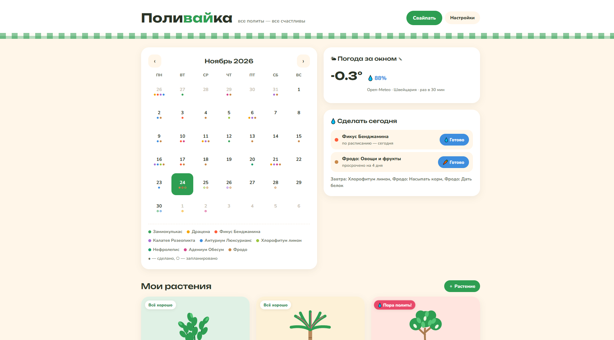
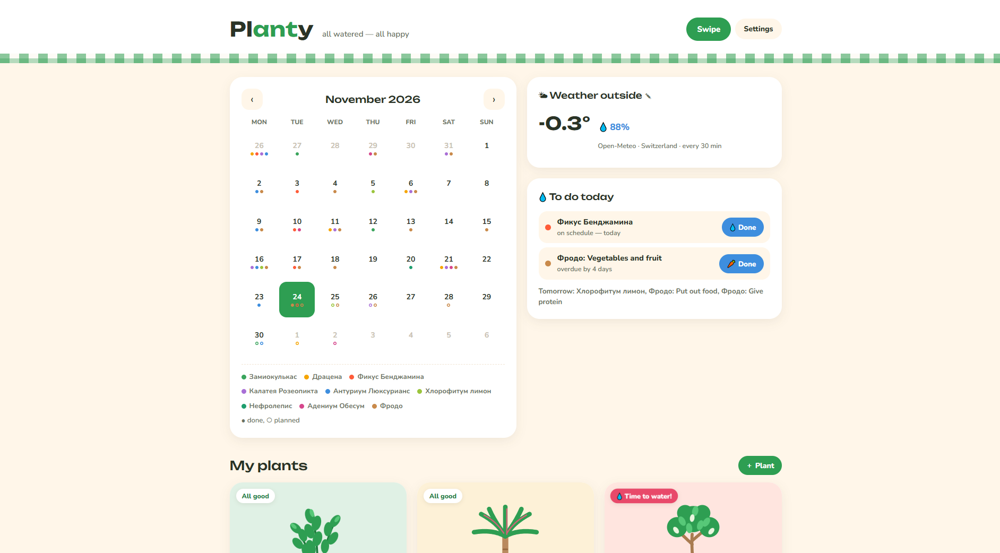
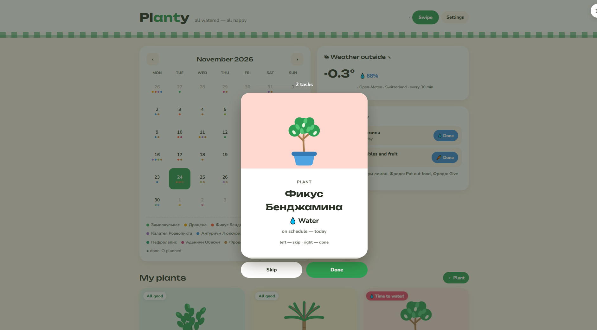
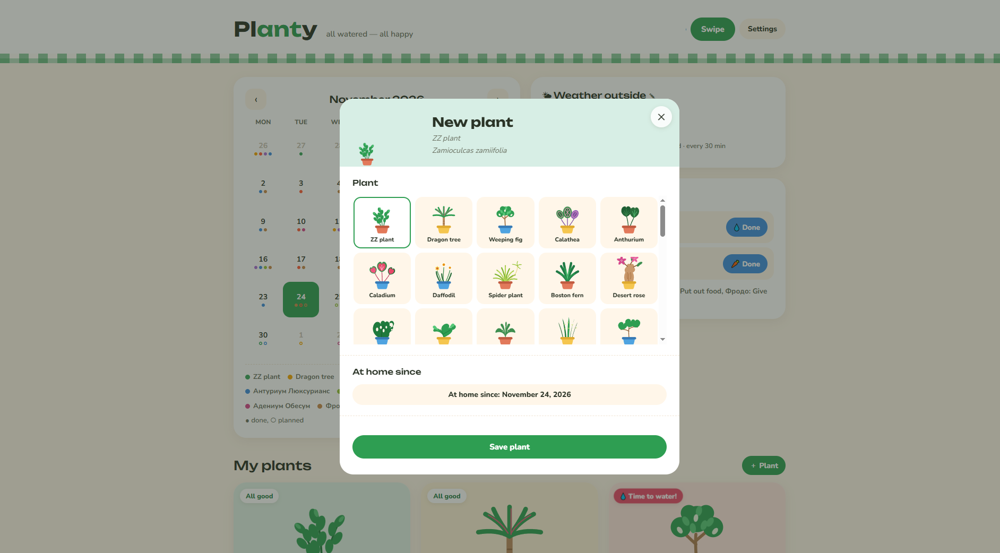

# Planty

Домашний трекер полива растений и дел питомцев. На русском приложение называется **Поливайка**: в логотипе зелёным выделено «вай». На остальных языках название — **Planty**, и зелёным выделены буквы «ant».

Интерфейс, названия из каталога и ответы ботаника следуют выбранному языку: английский, русский, испанский, немецкий, вьетнамский, китайский, французский, итальянский, хинди, японский.

## Как выглядит

Русская версия сохраняет прежнее имя.



На остальных языках шапка называется Planty.



Свайпы — колода дел на сегодня. Карточку можно пропустить или отметить выполненной.



Новое растение выбирается из каталога иллюстраций. Своё название и свои параметры ухода появляются только у пункта «Другое».



Интервал полива считается сам (сезон, температура, влажность) или задаётся вручную.


В настройках выбирается язык, часовой пояс, провайдер погоды и провайдер LLM: OpenRouter или Сбер (GigaChat). Список моделей загружается после ввода ключа.


## Что умеет

- Календарь поливов и дел: выполненные и запланированные дни, отдельный цвет у каждого растения.
- Погода по координатам дома. Провайдеры: Open-Meteo, MET Norway, wttr.in. Если с сервера прогноз не достать, страница запрашивает его из браузера.
- Условия у растения: температура и влажность в комнате. Пустое поле значит «как на улице».
- Умный интервал полива без LLM: базовый интервал, сезон, температура и влажность. Можно переключить на фиксированный интервал.
- Питомцы: вид, вода, еда и до шести своих дел с интервалом и эмодзи.
- Карточка с советами по уходу, заметками и вопросом ботанику. Модель отвечает на языке аккаунта.
- Отдельные аккаунты. Пароль хранится как scrypt-хеш.

## Запуск

Нужен Node.js 18 или новее.

```bash
npm install
npm start
```

Откройте http://localhost:3000. Порт меняется переменной `PORT` (см. `.env.example`).

Ключи OpenRouter и GigaChat вводятся в настройках аккаунта и в репозиторий не входят. Без ключа работает всё, кроме чата. Каталог моделей OpenRouter страница запрашивает из браузера: так чат работает и там, где сервер не может открыть TLS к OpenRouter.

## Данные

У каждого аккаунта свой файл в `data/users/<id>/data.json`. Пользователи и сессии лежат в `data/`. Эта папка в `.gitignore`: в репозитории нет аккаунтов, паролей и ключей. Новый аккаунт начинается пустым.

## Лицензия

[MIT](LICENSE). © 2026 Yury Mikhno.
