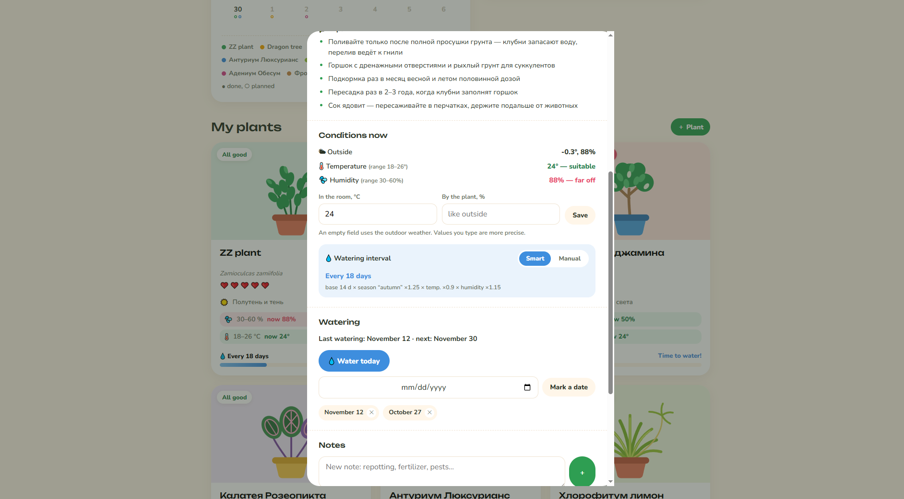
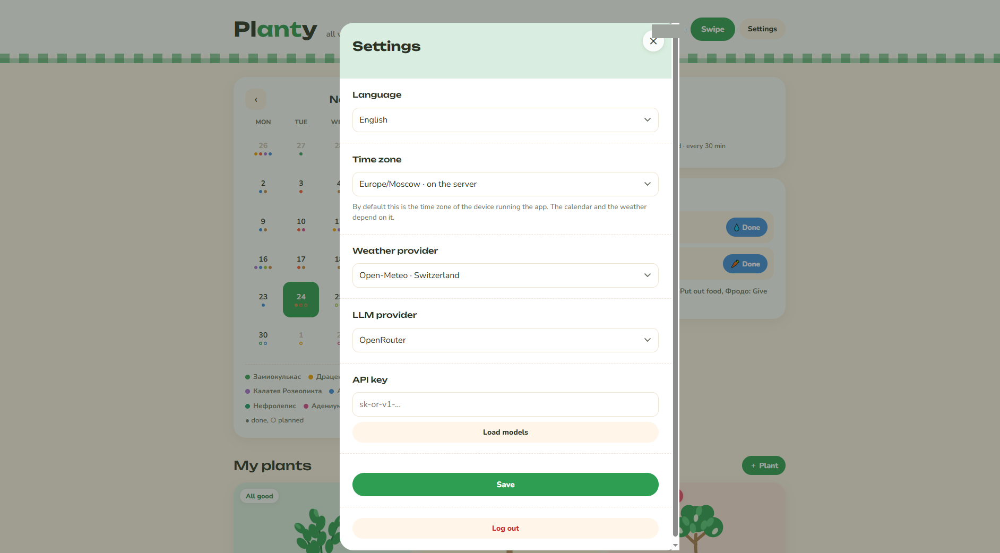

<div align="center">

  <h1>🌿 Planty</h1>
  <p><strong>Простое и быстрое приложение для растений и питомцев</strong></p>
  <p>Лёгкий интерфейс: календарь, дела на сегодня и карточка ухода. Без лишних экранов.</p>
  <p><strong>Автор:</strong> Yury Mikhno</p>

</div>

<div align="center">

[](https://nodejs.org/)
[](https://developer.mozilla.org/en-US/docs/Web/JavaScript)
[](https://expressjs.com/)

</div>

---

<p align="center">
  
</p>

Открыли — и сразу видно, кого полить и кого покормить. Данные остаются только у вас, на вашем компьютере.

---

## Что внутри

* **Быстрые дела.** Всё, что пора сделать, — одна колода. Свайп «готово» или «пропустить».
* **Лёгкие карточки.** Каталог растений с картинкой и уходом, питомцы со своими делами, календарь и погода у окна.
* **Свой ритм.** Интервал полива считается по сезону и погоде. Можно задать дни вручную.
* **Свой цветок.** Для растения «Другое» уход можно заполнить с помощью ИИ по латинскому названию.
* **Вопрос ботанику.** OpenRouter, OpenAI или Сбер. Ключ хранится только у вас. Без ключа календарь работает как обычно.
* **Русский и английский.**

<p align="center">
  
</p>

<p align="center">
  
</p>

<p align="center">
  
</p>

<p align="center">
  
</p>

---

## Запуск

Файлы лежат в [релизах](https://github.com/Duneholy/planty/releases). Node.js ставить не нужно.

### Windows

Скачайте архив, распакуйте его и дважды щёлкните **`Planty.bat`**. Браузер откроется сам. Закроете окно — Planty остановится.

### macOS

Скачайте **`Planty-1.0.2-universal.dmg`** из [релизов](https://github.com/Duneholy/planty/releases).

1. Откройте образ.
2. Запустите **`Install Planty.command`**. Если macOS спросит при первом запуске, выберите «Открыть».
3. Установщик кладёт Planty в «Программы», снимает метку загрузки и открывает приложение.

Дальше Planty запускается из «Программ» своим окном.

---

## С чего начать

1. Запустите Planty и создайте аккаунт — данные только у вас.
2. Укажите координаты дома, чтобы погода совпала с вашим окном.
3. Добавьте растения и, если есть, питомца.
4. Каждый день открывайте колоду дел.

---

## Как устроено

```
server.js          # приложение и календарь
lib/               # аккаунты, погода, ботаник, советы по уходу
public/            # интерфейс
Planty.bat         # запуск на Windows
desktop/main.js    # окно на macOS
data/              # ваши данные — создаются у вас и в репозиторий не входят
```

Стек: **Node.js** и **Express**.

---

## Лицензия

[MIT](LICENSE) © Yury Mikhno, 2026
